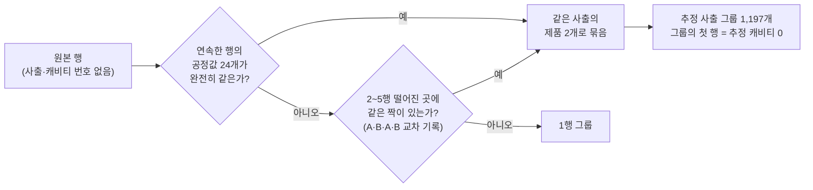
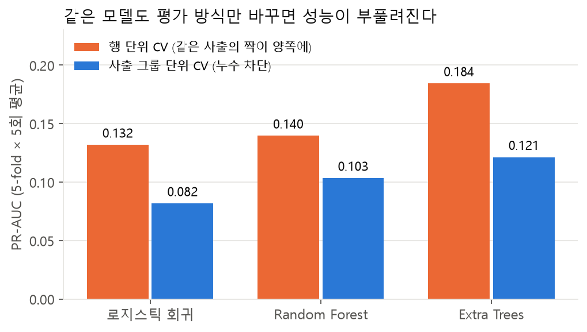
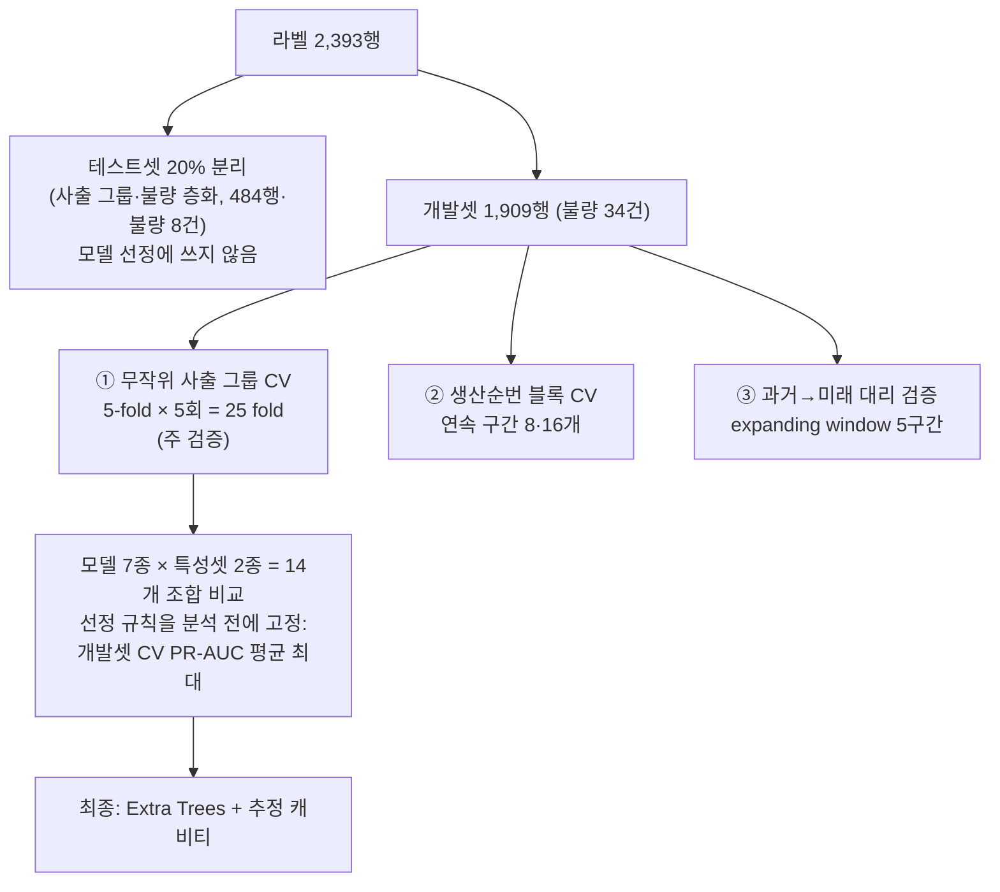
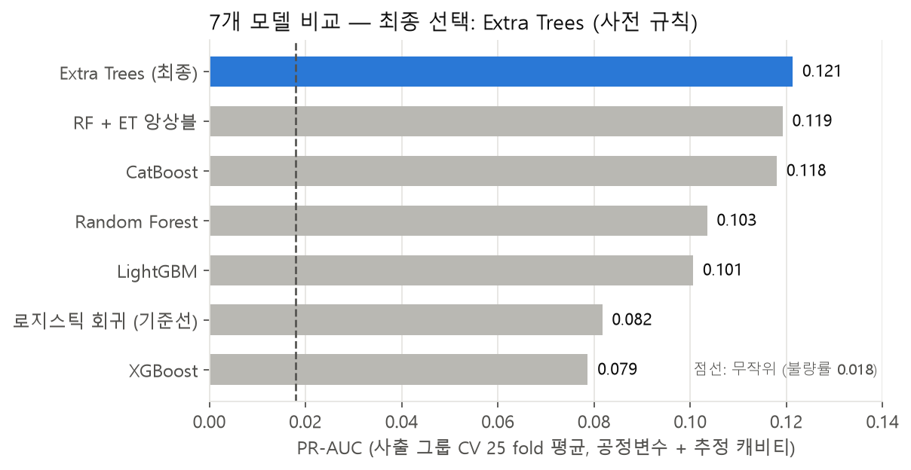
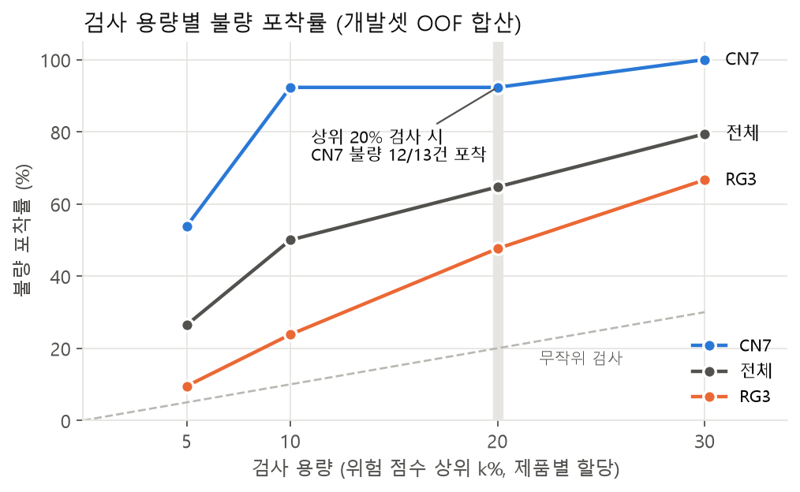
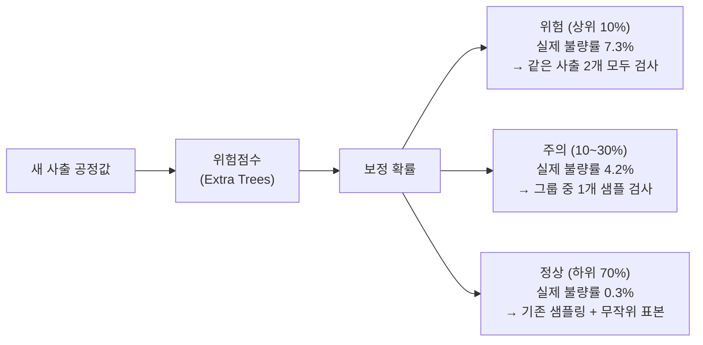

# 사출성형 공정데이터 기반 품질불량 위험 예측과 검사 우선순위 결정

> **제6회 K-인공지능 제조데이터 분석 경진대회 (KAMP) · 일반국민/대학(원)생 부문 · 개인 참가 (j2tori · 전건우) · 2026.09–10**
>
> 사출이 끝난 뒤 기록된 공정값으로 **품질검사 전에** 제품별 위험점수를 매겨,
> 한정된 검사 용량을 어디에 먼저 쓸지 정하는 **검사 보조 모델**입니다.
> 기존 품질검사를 대체하지 않고 검사 순서를 정합니다.

## 한눈에 보기

| 핵심 수치 | 의미 |
|---|---|
| **2-캐비티 구조 복원** | 공정값이 같은 2행 = 한 번의 사출. 데이터에 없는 사출·캐비티 번호를 공정값으로 추정 |
| **52%** | 행 단위로 검증했다면 부풀었을 성능. 모든 분할을 사출 그룹 단위로 바꿔 차단 (PR-AUC 0.184 → 0.121) |
| **0.121** | 최종 모델(Extra Trees + 추정 캐비티)의 PR-AUC. 무작위(불량률 0.018)의 **6.9배** |
| **12 / 13건** | CN7 제품 위험점수 상위 20%만 검사해도 포착하는 불량 (개발셋 OOF 합산) |
| **24배** | 보정 확률 기준 '위험' 등급의 실제 불량률(7.3%) ÷ '정상' 등급(0.3%) |
| **RG3 한계** | RG3 불량 25건 모두 공정값이 완전히 같은 양품이 존재 → 공정변수만으로는 구분 불가함을 진단 |

---

## 1. 문제와 데이터

| 구분 | 내용 |
|---|---|
| 현장 문제 | 최종검사에서야 불량을 확인해 선제 대응이 어렵고, 검사 자원이 모든 제품에 같은 비율로 투입됨 |
| 예측 시점 | 사출이 끝난 뒤, 품질검사 전 (사이클·충전 시간, 최대 사출압 등은 사출 중·후에 확정) |
| 목표 | ① 제품별 위험점수 ② 같은 검사 용량에서 불량 포착률 향상 ③ 오류 조건 파악과 현장 운영 규칙 도출 |
| 데이터 | 라벨 2,393행 (CN7 1,211 · RG3 1,182), 불량 42건 (1.8%), 공정변수 24개 + 비라벨 71,180행 (분포 진단에만 사용) |

## 2. 데이터에 숨은 구조 찾기



| 제품 | 최종 그룹 수 | 추정 캐비티 0 불량률 | 추정 캐비티 1 불량률 |
|---|---|---|---|
| CN7 | 606 | **2.1%** (13건) | 0.7% (4건) |
| RG3 | 591 | **3.9%** (23건) | 0.3% (2건) |

→ 불량 42건 중 **36건(86%)이 그룹의 첫 행**에 몰려 있다. 그래서 '추정 캐비티'를 특성으로 넣고, 같은 그룹이 학습과 평가에 나뉘지 않도록 **모든 분할을 사출 그룹 단위로** 설계했다.

**같은 그룹의 두 행이 학습·평가에 나뉘면 정답이 샌다.** 행 단위로 검증하면 성능이 크게 부풀려진다.

<p align="center"></p>

## 3. 모델링과 검증 설계



- **불균형(1.8%)** → 정확도 대신 PR-AUC(주지표)와 Recall@k%(검사 용량 k%에서의 포착률)를 씀
- **하이퍼파라미터는 탐색하지 않고 고정** → fold당 평가 불량이 6~7건이라 튜닝하면 잡음에 맞춰짐. 대신 모델 간 차이의 유의성(Nadeau-Bengio 보정 t, Holm 보정)을 함께 보고
- 입력 열 선택·임계값·확률 보정·스태킹은 **모두 각 학습 데이터 안에서만** 정하고, 모든 분할에서 같은 그룹이 양쪽에 들어가지 않음을 코드로 점검 (`split_audit`)

<p align="center"></p>

| 모델 (+추정 캐비티) | PR-AUC | ROC-AUC | Recall@20% |
|---|---|---|---|
| **Extra Trees (최종)** | **0.121** | 0.845 | **0.700** |
| RF + ET 앙상블 | 0.119 | 0.840 | 0.694 |
| CatBoost | 0.118 | 0.831 | 0.663 |
| Random Forest | 0.103 | 0.807 | 0.589 |
| LightGBM | 0.101 | 0.816 | 0.643 |
| 로지스틱 회귀 (기준선) | 0.082 | 0.770 | 0.530 |
| XGBoost | 0.079 | 0.784 | 0.551 |

- 상위 3개 조합의 차이(0.003)는 fold 간 표준편차보다 훨씬 작아 **통계적으로 구분되지 않는다.** 최종 모델은 "상위권과 비슷한 수준"으로 해석한다.
- **추정 캐비티의 효과는 유의하다:** 같은 Extra Trees에서 PR-AUC +0.033 (25승 0패, Holm p = 0.011)

### 하나의 숫자 대신 성능 범위

| 검증 | PR-AUC | 해석 |
|---|---|---|
| ① 무작위 사출 그룹 CV | 0.121 | 같은 기간 안의 일반화 (낙관적) |
| ② 생산순번 블록 CV | 0.045 ~ 0.060 | 같은 시기 사출을 학습에서 뺐을 때 (무작위의 2.5~3.4배) |
| ③ 과거→미래 대리 검증 | CN7 평가 불가 | CN7 불량이 가동 초기 한 구간에만 있어, 처음 보는 불안정 구간 예측은 이 데이터로 검증할 수 없음 |
| 테스트셋 (불량 8건) | 전체 0.343 · CN7 0.674 · RG3 0.017 | CN7 4건은 상위 5% 안에 모두 포함, RG3 4건은 포착 실패. 신뢰구간이 넓어 결론은 CV 중심 |

## 4. 운영안 — 예측을 검사 순서로

<p align="center"></p>

| 검사 용량 (제품별 상위 k%) | 5% | 10% | 20% | 30% |
|---|---|---|---|---|
| CN7 포착률 | 54% | 92% | **92%** | 100% |
| RG3 포착률 | 10% | 24% | 48% | 67% |
| 전체 포착률 | 26% | 50% | 65% | 79% |



| 운영 규칙 | 내용 |
|---|---|
| 가동 초기·금형 교체 직후 | 규칙으로 강화검사 (CN7 초기 50사출 전수검사 = 검사 10.3%로 불량 100%) |
| 안정 구간 | 모델 위험점수 상위 k% 검사 |
| RG3 | 공정변수 외 정보(캐비티별 센서)가 필요 → 추정 캐비티 0 샘플 검사 병행 |
| 공정 흔들림 사전경보 | 라벨 없이 작동하는 공정값 이동평균 경보 |
| 모니터링 | 검사 대상에서 빠진 제품 일부(2~5%)를 무작위 검사해 미탐지율 추정, 조건 충족 시 재학습 |
| 비용 시나리오 | 검사·유출 비용비 가정에 따른 최적 검사 비율 (CN7은 10% 안팎으로 안정) |

## 5. 검증한 것과 한계

- **비라벨 데이터를 쓰지 않은 이유:** 라벨·비라벨을 구분하는 분류기의 AUC가 1.00 → 분포가 완전히 달라 자기학습의 개선을 일반화로 볼 수 없음
- **RG3:** 불량 25건 모두 공정값이 같은 양품이 있어 공정변수만 보는 모델의 상한이 낮음 → 추가 수집 데이터 요구사항(변수 단위·측정 시점·사출/캐비티 번호 등) 정리
- **시간 일반화:** 처음 겪는 불안정 구간을 미리 예측할 수 있는지는 검증할 수 없음 → 규칙과 사전경보로 보완하고 검사 결과를 라벨로 쌓아 재학습
- 모든 수치는 개발셋 오프라인 검증 결과이며, 실제 효과는 시범 운영으로 확인해야 함

---

## 저장소 구성

| 경로 | 내용 |
|---|---|
| [`사출성형_모델/`](사출성형_모델/) | 분석 코드 — `run_all.py`(전체 파이프라인), `predict.py`(저장 모델로 추론), `analysis.ipynb`, `src/` (데이터 구조 복원·모델·평가·운영 분석·실험). 실행 방법은 [사출성형_모델/README.md](사출성형_모델/README.md) |
| `제출자료/` | 최종 결과보고서(PDF·DOCX)와 발표자료(PDF·PPTX) |
| `보고서/analysis_해설지.pdf` | 분석 노트북 해설 |
| `작업기록_검토반영_1005.md` | 검토 의견 반영 기록 |
| `docs/readme/` | 이 README의 요약 차트 (집계 결과로 생성) |

> **데이터는 포함하지 않았습니다.** KAMP 제공 데이터셋은 재배포가 금지되어 있어 원본·가공 데이터와 결과 CSV를 제외했고, 노트북에서도 원본 행이나 샘플별 라벨이 보이는 출력은 지웠습니다.

## 빠른 실행

```bash
cd 사출성형_모델
pip install -r requirements.txt
python run_all.py                 # 전체 실행 → outputs/ (CPU 약 1시간)
python run_all.py --quick         # CV 반복 1회 점검용
python predict.py --input data/moldset_labeled_cn7.csv --product cn7  # 저장 모델로 추론
```

KAMP 데이터셋 4개 파일(`moldset_labeled/unlabeled_cn7/rg3.csv`)을 `사출성형_모델/data/`에 넣어야 합니다.

---

**기술:** Python · scikit-learn(Extra Trees, Random Forest, 로지스틱 회귀) · LightGBM · XGBoost · CatBoost · SHAP · 그룹 교차검증 · 확률 보정 · Nadeau-Bengio 보정 t-검정

---

👤 [전건우 GitHub 프로필](https://github.com/j2tori-design) · 📂 [전체 프로젝트 목차](https://github.com/j2tori-design/contest-portfolio)
